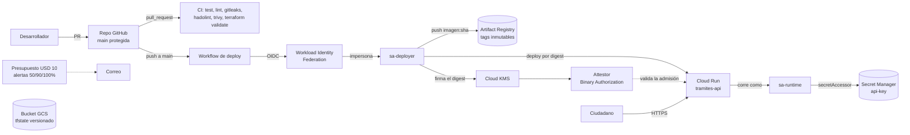

# tramites-platform

Plataforma mínima de despliegue para un servicio público de **consulta de estado de trámite**: el
ciudadano ingresa su número y ve en qué va. La aplicación es deliberadamente simple (una API en Go
de un solo archivo); lo que se diseñó con cuidado es la plataforma: entrega segura, inmutable,
barata y automatizada.

**Parte B elegida: Opción 1, Binary Authorization.** Cloud Run solo arranca imágenes atestadas por el
pipeline. La prueba de que una imagen sin atestar es rechazada está en
[docs/evidencias/binauthz-rechazo.txt](docs/evidencias/binauthz-rechazo.txt).

## Qué es y qué no es

| Es | No es |
|---|---|
| API en Go (`/health` y `/v1/tramites/{numero}`) con datos de prueba en memoria | Un sistema real de trámites: no hay base de datos |
| Terraform con estado remoto en GCS, pipeline en GitHub Actions, despliegue en Cloud Run | Un entorno de producción: es un solo ambiente (`dev`) en un solo proyecto |
| Imágenes firmadas con una llave en Cloud KMS y verificadas por Binary Authorization | Una solución multi-región, con alta disponibilidad ni con SLOs definidos |

## Arquitectura



## Estructura del repositorio

```
app/                 API en Go (main.go, tests, Dockerfile multistage no-root)
infra/bootstrap/     Terraform con estado local: APIs, bucket del estado, presupuesto
infra/platform/      Terraform con estado remoto: registry, Cloud Run, secreto, IAM, WIF, KMS, Binary Authorization
.github/workflows/   ci.yml (pull requests) y deploy.yml (push a main)
scripts/             setup-dev.sh, test-secret-hooks.sh, check-branch-name.sh, demo-binauthz-reject.sh
docs/evidencias/     Evidencia del rechazo de Binary Authorization
CRITERIO.md          Respuestas de criterio (Parte C)
3dtour/             Recorrido guiado en 3D de toda la plataforma (abrir index.html)
```

## Despliegue desde cero

Pasos copiables. Los valores entre `<...>` son los tuyos.

### 0. Requisitos
`git`, `gh`, `gcloud`, `terraform` (≥ 1.9; se usó 1.16.6), `docker`, `go` (1.27), `python3`.
`pre-commit` y `gitleaks` los instala `setup-dev.sh` (pide confirmación).

```bash
git clone https://github.com/<owner>/<repo>.git && cd <repo>
./scripts/setup-dev.sh            # registra los hooks y escanea el repositorio
./scripts/test-secret-hooks.sh    # comprueba que la barrera bloquea secretos falsos
gh auth login
```

### 1. Proyecto de GCP
El proyecto se crea una sola vez, a mano (Terraform necesita un proyecto existente donde trabajar).

```bash
gcloud auth login
gcloud auth application-default login      # Terraform usa estas credenciales, no las de gcloud
gcloud projects create <project_id>
gcloud billing projects link <project_id> --billing-account=<billing_account_id>
gcloud config set project <project_id>
gcloud auth application-default set-quota-project <project_id>
```

### 2. Bootstrap (estado local)
Crea el bucket del estado, habilita las APIs y define el presupuesto.

```bash
cd infra/bootstrap
cp terraform.tfvars.example terraform.tfvars   # edita los valores; el archivo no se versiona
terraform init
terraform apply
```
Si falla con `SERVICE_DISABLED` sobre Cloud Resource Manager, es propagación de una API recién
habilitada: espera un minuto y repite `terraform apply`.

### 3. Plataforma (estado remoto)
```bash
cd ../platform
cp terraform.tfvars.example terraform.tfvars   # edita los valores
terraform init -backend-config="bucket=<project_id>-tfstate"

# 3.1 Solo el contenedor del secreto: Cloud Run exige que la versión 1 exista al crear el servicio
terraform apply -target=google_secret_manager_secret.api_key
printf '%s' "$(openssl rand -hex 24)" | gcloud secrets versions add api-key --data-file=-

# 3.2 Todo lo demás, sin Binary Authorization: la imagen inicial no está atestada
terraform apply -var enable_binauthz=false

# 3.3 Activar Binary Authorization (llave KMS, attestor, política)
terraform apply
```
El paso 3.3 puede fallar una vez si la llave KMS aún no terminó de generarse: repite el comando.

### 4. Variables de GitHub
No son secretos (ninguno es sensible), por eso son *Variables* y no *Secrets*.

```bash
REPO=<owner>/<repo>
gh variable set GCP_PROJECT_ID           --repo $REPO --body "<project_id>"
gh variable set GCP_REGION               --repo $REPO --body "us-central1"
gh variable set SERVICE_NAME             --repo $REPO --body "tramites-api"
gh variable set WIF_PROVIDER             --repo $REPO --body "$(terraform output -raw wif_provider)"
gh variable set DEPLOYER_SERVICE_ACCOUNT --repo $REPO --body "$(terraform output -raw deployer_service_account)"
gh variable set AR_REPO                  --repo $REPO --body "$(terraform output -raw artifact_registry_repo)"
gh variable set ATTESTOR                 --repo $REPO --body "$(terraform output -raw attestor_name)"
gh variable set KMS_KEY_VERSION          --repo $REPO --body "$(terraform output -raw kms_key_version)"
```

### 5. Protección de la rama `main`
```bash
gh api -X PUT repos/<owner>/<repo>/branches/main/protection --input - <<'EOF'
{
  "required_status_checks": { "strict": true, "contexts": ["app", "docker", "security", "terraform"] },
  "enforce_admins": true,
  "required_pull_request_reviews": { "required_approving_review_count": 0 },
  "restrictions": null,
  "allow_force_pushes": false,
  "allow_deletions": false,
  "required_conversation_resolution": true
}
EOF
```

### 6. Primer despliegue
El despliegue se dispara con un push a `main` que cambie `app/**` o `deploy.yml`. Haz un cambio mínimo
por pull request, o reejecuta el workflow *Deploy* desde la pestaña Actions.

### 7. Verificación
```bash
curl -s "$(terraform -chdir=infra/platform output -raw service_url)/health"
# {"secret_configured":true,"status":"ok","version":"<sha corto del commit>"}
./scripts/demo-binauthz-reject.sh        # debe terminar con: Rejected as expected
```

### Problemas conocidos al desplegar
| Síntoma | Causa | Qué hacer |
|---|---|---|
| `SERVICE_DISABLED` en un `apply` recién hecho | Propagación de una API recién habilitada | Esperar y repetir el `apply` |
| Cloud Run falla al crearse con un error de secreto | La versión 1 de `api-key` no existe | Seguir el paso 3.1 |
| El `apply` del attestor falla | La llave KMS aún se está generando | Repetir el `apply` |
| `pool already exists` tras destruir y recrear | Workload Identity reserva el ID del pool 30 días | Ver la sección de destrucción |

## Decisiones

| Decisión | Se descartó | Por qué |
|---|---|---|
| **GitHub Actions + Workload Identity Federation**, impersonando una service account propia del pipeline | Una llave JSON de service account en GitHub Secrets; Cloud Build | Sin credenciales de larga vida que se puedan filtrar. Cloud Build habría exigido conectar el repo y trae su propia cuenta por defecto, con más permisos |
| **Desplegar por digest** (`imagen@sha256:...`) con el SHA de Git como tag y **tags inmutables** | Desplegar por tag; usar `:latest` | El digest identifica los bytes exactos y es lo que Binary Authorization atesta. Un tag inmutable no se puede mover a otra imagen |
| **Terraform crea el servicio de Cloud Run; el pipeline solo cambia la imagen** (`ignore_changes` sobre la imagen) | Que el pipeline cree todo con `gcloud run deploy`; que Terraform despliegue cada versión | Separa la plataforma (cambia poco, la gobierna Terraform) de la entrega (cambia mucho, la gobierna el pipeline) sin que se pisen el estado |
| **El valor del secreto no pasa por Terraform** | `google_secret_manager_secret_version` con el valor; `random_password` | El valor quedaría en texto plano en el archivo de estado. Terraform solo crea el contenedor del secreto y los permisos |
| **Bootstrap separado con estado local** y plataforma con estado remoto | Crear el bucket a mano; un solo directorio de Terraform | Resuelve que el bucket del estado no puede guardar el estado de su propia creación, y todo sigue siendo destruible con Terraform. El presupuesto vive en el bootstrap: es lo primero que se crea y lo último que se destruye |
| **Binary Authorization activada en dos tiempos**: primero el servicio con una imagen inicial sin política, luego se activa tras una imagen atestada | Una lista de excepción permanente para la imagen inicial | Una excepción permanente es un hueco. El costo es un paso extra al desplegar desde cero |
| **Cloud Run al mínimo coste**: 0 instancias mínimas, máximo 3, 1 vCPU / 512 Mi, CPU solo durante las solicitudes | Instancias mínimas > 0; GKE | Costo casi cero con la capa gratuita. El máximo de instancias es el tope duro de gasto |
| **Tags inmutables aunque impidan la limpieza automática** | Quitar la inmutabilidad para que funcione la política de limpieza | Artifact Registry no deja borrar imágenes con tag en un repo inmutable, y todas las nuestras llevan tag. Se prefirió la inmutabilidad; las imágenes pesan ~9 MB, centavos al mes |
| **Terraform se aplica desde la estación de trabajo**; en CI solo `fmt` y `validate` | Un pipeline de `terraform apply` | Evita darle permisos de Owner a una cuenta de CI. Queda como pendiente |
| **Acciones de GitHub fijadas por SHA** y permisos mínimos por workflow | Fijarlas por tag (`@v4`) | Un tag de una acción se puede mover; un SHA no |
| **Repositorio público** | Repositorio privado | La protección de ramas en repos privados requiere un plan de pago y los evaluadores necesitan lectura. Por eso gitleaks es obligatorio |

## Protección contra secretos

Defensa en capas, porque cualquier capa sola se puede saltar:

1. `.gitignore` deja fuera `.env`, `*.tfvars`, `*.tfstate*` y archivos de llaves.
2. Hooks de pre-commit: gitleaks, detección de llaves privadas, bloqueo por nombre de archivo
   sensible y por contenido de llaves de service account de GCP.
3. El mismo `.pre-commit-config.yaml` corre en CI (job `security`) y **impide el merge**. Un hook
   local se puede saltar con `--no-verify` o no estar instalado; CI no.
4. gitleaks escanea todo el historial en CI.
5. Un test comprueba que la barrera bloquea secretos falsos: `./scripts/test-secret-hooks.sh`.

Si un secreto llega a GitHub: **primero rotarlo** (ya está comprometido), después limpiar el
historial con `git filter-repo` y avisar. Reescribir el historial por sí solo no basta.

## Parte B: Binary Authorization

**Cómo funciona.** El pipeline sube la imagen, obtiene su digest y pide a Cloud KMS que lo firme con
una llave asimétrica; la firma queda guardada como atestación. La política del proyecto exige que
toda imagen tenga una atestación válida del attestor `pipeline-attestor`, sin lista de excepciones.
Cloud Run verifica la política al crear cada revisión. La llave privada nunca sale de KMS: la service
account del pipeline puede pedir una firma, pero no leer la llave.

**Cómo probar el rechazo.**
```bash
./scripts/demo-binauthz-reject.sh
```
Sube una imagen sin firmar, intenta desplegarla por digest y guarda el rechazo. El mensaje clave es
`denied by attestor ... No attestations found that were valid and signed by a key trusted by the
attestor`. En Cloud Logging la denegación aparece como un evento de auditoría de Cloud Run:
```
protoPayload.status.message:"denied by attestor"
```

**Efecto secundario conocido de la demo.** El intento rechazado deja una revisión fallida y el
servicio queda con la condición `Ready: False` (`ContainerImageUnauthorized`); la plantilla del
servicio apunta a la imagen rechazada y `terraform plan` muestra una diferencia en el nombre de la
revisión. El tráfico sigue en la última revisión buena y `/health` responde con normalidad.
Redesplegar la imagen buena deja `terraform plan` limpio; la condición `Ready` del servicio se
normaliza con el siguiente despliegue real del pipeline:
```bash
GOOD=$(gcloud run revisions describe <revision-buena> --region us-central1 --format='value(spec.containers[0].image)')
gcloud run deploy tramites-api --image "$GOOD" --region us-central1 --quiet
```
`gcloud` puede imprimir `Deployment failed` con el mensaje de la revisión rechazada aunque la
revisión nueva sí se haya creado: lee una condición obsoleta del servicio.

**Evidencia.** [docs/evidencias/binauthz-rechazo.txt](docs/evidencias/binauthz-rechazo.txt) y la
captura de Cloud Logging.

**Break-glass (emergencia).** Cloud Run permite saltarse la política con una justificación:
```bash
gcloud run deploy tramites-api --image <imagen> --region us-central1 --breakglass="INC-123: motivo"
```
Queda registrado en la auditoría, con la justificación, y el siguiente despliegue normal limpia el
bypass. **Limitación honesta:** cualquier identidad que pueda actualizar el servicio puede usar el
break-glass, incluida la service account del pipeline. Impedirlo de forma estricta exige una política
de organización (*Allowed Binary Authorization Policies*), que no existe en un proyecto personal sin
organización. Queda en los pendientes, junto con una alerta basada en logs para cada uso.

## Seguridad: cuentas de servicio, roles y alcance

| Identidad | Rol | Alcance |
|---|---|---|
| `sa-runtime` (identidad de Cloud Run) | `secretmanager.secretAccessor` | Solo el secreto `api-key` |
| `sa-deployer` (identidad del pipeline) | `artifactregistry.writer` | Solo el repositorio `tramites` |
| | `run.developer` | Solo el servicio `tramites-api` |
| | `iam.serviceAccountUser` | Solo `sa-runtime` |
| | `cloudkms.signerVerifier` | Solo la llave `pipeline-signer` |
| | `containeranalysis.notes.attacher` | Solo la nota del attestor |
| | `binaryauthorization.attestorsViewer` | Solo el attestor |
| | `containeranalysis.occurrences.editor` | **Proyecto** |
| GitHub Actions (identidades externas) | `iam.workloadIdentityUser` sobre `sa-deployer` | Solo este repositorio y solo la rama `main` |
| Cualquiera (`allUsers`) | `run.invoker` | Solo el servicio `tramites-api`: es público por ser un servicio ciudadano |

El único permiso a nivel de proyecto es el de atestaciones: las atestaciones (*occurrences*) no admiten
permisos por recurso en Container Analysis. Solo permite crear y editar atestaciones; no lee secretos,
no cambia infraestructura ni despliega. Ninguna cuenta de servicio tiene `editor` ni `owner`.
La condición del provider de Workload Identity rechaza cualquier repositorio o rama distinta.

## Costos

| Recurso | Costo estimado |
|---|---|
| Cloud Run (0 a 3 instancias, CPU solo durante solicitudes) | ≈ USD 0: dentro de la capa gratuita con este tráfico |
| Artifact Registry (imágenes de ~9 MB) | Centavos por GB-mes; las imágenes se acumulan (ver decisiones) |
| Secret Manager (1 secreto, 1 versión) | Centavos al mes |
| Cloud KMS (1 llave asimétrica) | Centavos al mes por versión de llave, más centavos por firma |
| Bucket del estado de Terraform | Unos KB: ≈ USD 0 |
| Workload Identity, IAM, presupuestos | Sin costo |

Controles: un presupuesto de USD 10 con alertas al 50 %, 90 % y 100 % del gasto real y al 100 % del
pronóstico, y un máximo de 3 instancias en Cloud Run. **Un presupuesto avisa, no corta el gasto.**

## Destrucción

El orden importa: primero `platform` (necesita el estado remoto) y después `bootstrap`
(que borra el bucket de estado y el presupuesto).

```bash
cd infra/platform  && terraform destroy
cd ../bootstrap    && terraform destroy
```

Avisos:
- **Key ring de KMS:** los key rings no se pueden borrar en GCP y las llaves solo quedan
  programadas para destrucción. `terraform destroy` termina bien, pero deja un key ring vacío
  (costo residual de centavos). Para volver a desplegar hay que importarlo o cambiar el nombre.
- **Pool de Workload Identity:** GCP lo borra de forma suave durante 30 días y reserva su ID.
  Redesplegar con el mismo ID en ese plazo falla; usa otro `workload_identity_pool_id`.
- **Imágenes con tags inmutables:** si Terraform no pudiera borrar el repositorio por contener
  imágenes con tag, habría que borrarlo con `gcloud artifacts repositories delete tramites`.
- El bucket del estado usa `force_destroy = true` para poder destruirlo. Es aceptable en un
  laboratorio desechable; no en producción.
- Las APIs habilitadas no se deshabilitan al destruir (`disable_on_destroy = false`), a propósito.

## Pendientes (qué haría con más tiempo)

- Pipeline de `terraform plan/apply` con una service account dedicada, y **detección de drift**
  programada (la Opción 2 de la Parte B).
- Política de organización *Allowed Binary Authorization Policies* y una alerta por cada uso de
  break-glass.
- Retención de imágenes compatible con la inmutabilidad: tags solo en versiones publicadas y los
  builds de cada commit sin tag, o repositorios separados por ambiente.
- SemVer automático (release-please), ambientes dev/prod en proyectos separados.
- SLOs y alertas de latencia y errores; Cloud Armor y límites de tasa.
- Firma con Sigstore/cosign y SBOM; VPC Service Controls.
- Plantillas del camino pavimentado para Python y React.
- Validar el despliegue desde cero con un proyecto limpio de punta a punta.
- La API no tiene cierre ordenado (*graceful shutdown*), ni validación de entrada, ni logs estructurados.

## Flujo de trabajo

Trunk-based. Las ramas son `feature/DEVOPS-NN-descripcion`, `fix/DEVOPS-NN` o `hotfix/DEVOPS-NN`;
los commits siguen Conventional Commits; todo entra a `main` por pull request con los cuatro checks
(`app`, `docker`, `security`, `terraform`) en verde.

## Uso de IA

Usé Claude Code (Anthropic) para generar código, Terraform y documentación bajo mi dirección; revisé
el resultado y puedo explicar cada parte. Los commits asistidos llevan el trailer `Co-Authored-By`
que agrega el asistente. Varios commits de la infraestructura de las primeras etapas no lo
conservaron, aunque también fueron asistidos; los menciono aquí para que conste. Las operaciones de Git
las ejecuté yo.
